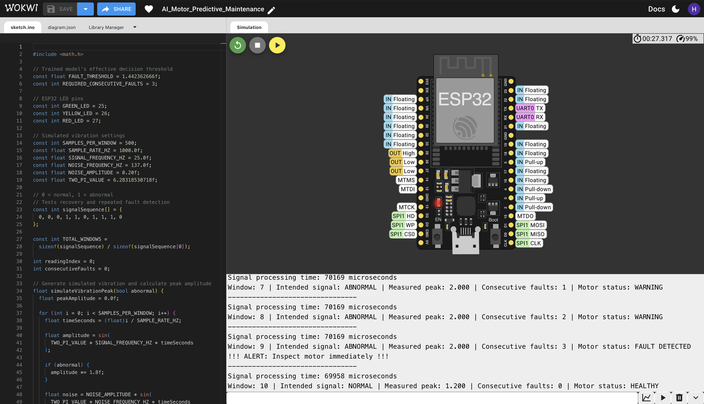
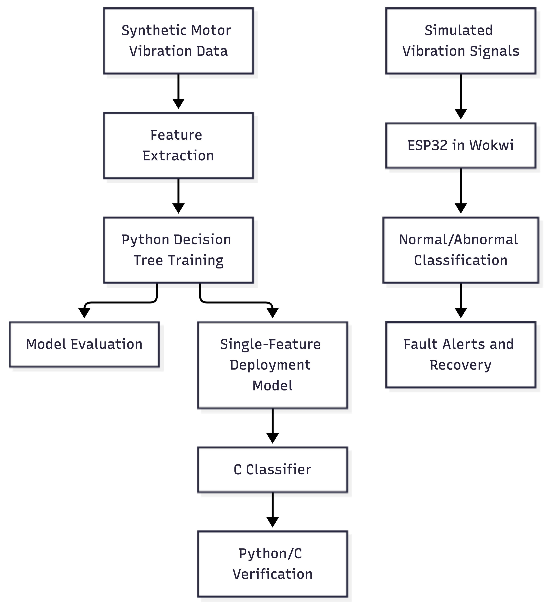

# AI-Based Predictive Maintenance Using TinyML

## Project Overview

This project explores a simulation-first approach to AI-based predictive maintenance using embedded systems. A lightweight machine-learning classifier analyses motor vibration features to classify motor conditions as normal or abnormal.

The project combines Python-based model development, C-based classification, and ESP32 simulation using Wokwi. It also includes exploratory analysis of the NASA IMS bearing vibration dataset.

## Final Project Report

**[Read the Final Project Report](FINAL_PROJECT_REPORT.md)** for the complete methodology, model evaluation, Python/C verification, Wokwi simulation results, NASA IMS investigation, limitations, and future work.

For detailed experimental metrics and additional analysis, see [benchmark_report.md](benchmark_report.md).

## Objectives

- Generate and evaluate a synthetic motor vibration dataset.
- Train a lightweight decision-tree classifier.
- Implement a compatible classification rule in C.
- Verify Python/C prediction agreement and decision-boundary behaviour.
- Simulate vibration monitoring and fault alerts on an ESP32 using Wokwi.
- Explore real-world vibration data and document data-quality limitations.

## Technologies Used

- Python, NumPy, Pandas
- scikit-learn
- C
- VS Code
- ESP32 simulation with Wokwi
- Git and GitHub

## Machine Learning Results

The three-feature evaluation model achieved **81.25% test accuracy** on 80 held-out samples from a synthetic dataset.

- Validation accuracy: 78.75%
- Abnormal recall: 80%
- Normal recall: 82%
- Model: Decision tree with maximum depth 2

These metrics apply to the three-feature evaluation model and the synthetic dataset, not to real motor measurements.

### Embedded Classifier Verification

A separate one-feature decision-tree model uses `peak_amplitude`. Its C implementation was compared against the corresponding Python model.

- Dataset predictions compared: 400
- Matching predictions: 400
- Mismatches: 0
- Additional boundary inputs compared: 10
- Boundary mismatches: 0

These results establish prediction agreement for the tested inputs; they do not establish real-world fault-detection accuracy.

### Repeated-Split Evaluation

Across five random train/test splits of the same synthetic dataset, the one-feature deployment model achieved:

- Mean accuracy: 81.25%
- Accuracy range: 77.50%–86.25%

These are exploratory repeated-split results on the same dataset, not validation across independent motors or datasets.

## ESP32 Simulation

The Wokwi simulation demonstrates:

- Simulated vibration signal generation
- Normal/abnormal classification
- Consecutive-fault detection
- Recovery behaviour

**[Run the ESP32 simulation on Wokwi](https://wokwi.com/projects/478114371222432769)**

Simulation behaviour and timing are not equivalent to measurements on physical ESP32 hardware.

## NASA IMS Dataset Investigation

The project includes exploratory analysis of 984 timestamped files from the second test set of the NASA IMS bearing dataset. RMS, standard deviation, and peak amplitude were calculated for the first sensor channel.

Two files contained near-zero vibration measurements and were flagged for further investigation. The cause has not been established.

This analysis is exploratory: individual fault labels have not been assigned, and no real-world fault-detection accuracy is claimed.

- `analyze_nasa_data.py` — extracts vibration features from the downloaded dataset.
- `plot_nasa_features.py` — plots feature trends over time.
- `nasa_data_quality_report.md` — documents the findings and limitations.

**Dataset source:** [NASA IMS Bearing Dataset](https://data.nasa.gov/dataset/ims-bearings)

The raw dataset archives and extracted files are excluded from Git. Follow the dataset source's terms and instructions when obtaining the data.

## Wokwi ESP32 Simulation

The ESP32 simulation demonstrates vibration monitoring, consecutive-fault detection, and recovery.



The simulation demonstrates:

- **Warning:** Two consecutive abnormal vibration windows.
- **Fault detection:** Three consecutive abnormal windows trigger an alert to inspect the motor.
- **Recovery:** A normal vibration window resets the fault count and returns the status to healthy.

**Note:** This is a Wokwi simulation, not a physical hardware test.

## Reproducing the Results

### 1. Set up the Python environment

Python and the dependencies listed in `requirements.txt` are required.

```bash
python3 -m venv .venv
source .venv/bin/activate
python -m pip install -r requirements.txt
```

### 2. Run the automated tests

```bash
python -m pytest -v
```

### 3. Verify Python/C agreement

```bash
python test_python_c_agreement.py
```

Expected result: 400 matching predictions and zero mismatches on the synthetic dataset.

### 4. Compare the saved models

```bash
python verify_final_model_comparison.py
```

This compares the three-feature evaluation model and one-feature deployment model on the same held-out test split. The recorded result is 81.25% accuracy for each model, with matching predictions on all 80 test samples.

### 5. Reproduce feature selection

Run the feature-selection experiment to compare different feature sets and decision-tree depths using validation metrics:

```bash
python compare_feature_models.py
```

The experiment selects a model using validation abnormal-class F1, breaking ties by fewer tree nodes and then higher validation accuracy. It evaluates the selected model on the held-out test set and saves the deployment model to `motor_fault_feature_model.joblib`.

The recorded selection was a depth-2 decision tree using `peak_amplitude` only, with 78.75% validation accuracy and 81.25% held-out test accuracy.

**Note:** This experiment uses synthetic data. Its results do not establish real-world motor fault-detection performance.

### 6. Review the benchmark report

Open `benchmark_report.md` for the dataset split, model metrics, threshold experiments, simulation results, and limitations.

**Note:** Run these commands from the repository root. The dataset and saved model files must be present. The results are based on synthetic data and do not establish real-world motor fault-detection performance.

## Project Structure

| File | Purpose |
|---|---|
| `evaluate_final.py` | Evaluates the three-feature model |
| `motor_classifier.c` | C classification implementation |
| `motor_fault_feature_model.joblib` | One-feature deployment model |
| `motor_fault_feature_list.json` | Deployment feature configuration |
| `test_python_c_agreement.py` | Python/C prediction agreement tests |
| `test_noise_robustness.py` | Noise robustness tests |
| `benchmark_report.md` | Model evaluation and benchmark results |
| `wokwi_test_results.md` | ESP32 simulation test results |
| `analyze_nasa_data.py` | NASA dataset feature extraction |
| `plot_nasa_features.py` | NASA feature trend plots |
| `nasa_data_quality_report.md` | NASA data-quality findings |

## Limitations

- The primary training and evaluation dataset is synthetic.
- Real-world predictive-maintenance accuracy has not been established.
- The NASA analysis does not currently establish fault labels or validated fault-detection performance.
- Wokwi results do not establish physical hardware performance.
- Memory use, inference latency, and power consumption on physical hardware have not been benchmarked.
- The project is a prototype and requires further validation before practical deployment.

## Future Work

- Validate the classifier using appropriately labelled real motor vibration data.
- Investigate the NASA dataset's recording conditions and unusual measurements.
- Evaluate false alarms and missed faults on independent data.
- Deploy on physical ESP32 hardware.
- Measure memory use, inference latency, and power consumption.

## System Architecture

The diagram below shows the workflow from synthetic vibration data and Python model development to C classification and ESP32 simulation.



See [architecture.md](architecture.md) for the editable Mermaid source.

## ESP32 Firmware Resource Measurements

The firmware was successfully compiled using Arduino CLI with ESP32 Arduino Core 3.3.12.

| Metric | Result |
|---|---:|
| Program storage used | 274,444 bytes (20%) |
| Static/global RAM used | 22,548 bytes (6%) |
| RAM remaining according to compiler | 305,132 bytes |
| Build status | Successful |

**Build target:** `esp32:esp32:esp32` (ESP32 Dev Module).

These are compiler-reported resource measurements for the simulated vibration-monitoring firmware. The firmware generates synthetic samples rather than reading a physical vibration sensor. The exact Wokwi board configuration and physical hardware performance have not yet been verified.
