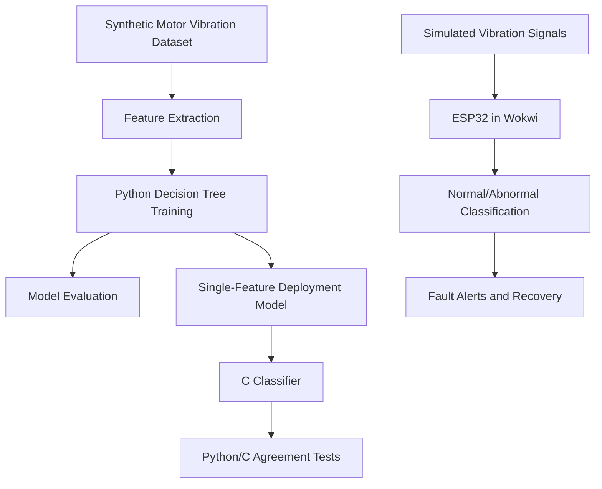

# System Architecture

## Workflow

1. Generate synthetic vibration data and extract RMS, standard deviation, and peak amplitude.
2. Train and evaluate the decision-tree model in Python.
3. Use a single peak-amplitude feature for the lightweight C classifier.
4. Verify Python/C prediction agreement.
5. Simulate vibration monitoring and fault alerts using ESP32 in Wokwi.

**Scope:** This is a simulation-first prototype. Physical ESP32 deployment and real-world fault-detection accuracy have not been validated.
